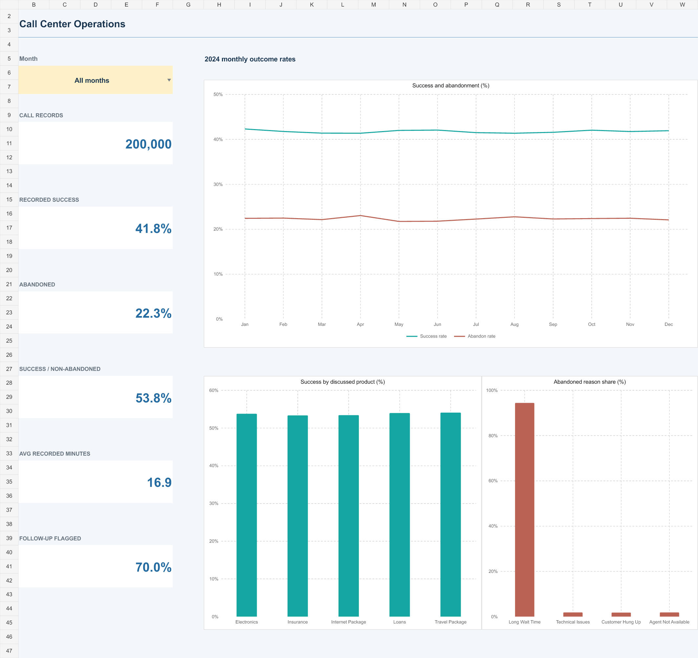

# Call Center Operations MIS

An Excel reporting project built from 200,000 call records covering 2024. It tracks recorded outcomes, abandonment, follow-up flags, workload and call duration without treating operational labels as verified revenue.

[Download the Excel workbook](Call_Center_Operations_MIS.xlsx)

## Analysis

The source contains 83,519 Success, 71,837 Failure and 44,644 Abandoned records. Recorded success represents 41.76% of all calls and 53.76% of non-abandoned calls. Abandonment is 22.32%. Long Wait Time is the recorded reason for 42,160 abandoned calls, or 94.44% of abandoned records.

The reason distribution makes queue access a useful area for further investigation. Confirm actual waiting times and routing before proposing staffing changes. Agent comparisons describe the recorded workload and outcomes; they do not control for call mix or demonstrate individual effectiveness.

## Workbook

- **Call Review:** month selector, six operational KPIs, a full-year monthly trend, discussed-product outcome comparison, abandoned-reason chart and agent matrix.
- **Daily MIS:** month selector, daily volume, success, abandonment, mean recorded duration and day-over-day volume change.
- **Period MIS:** Monday-start weeks, monthly and quarterly totals, plus the 2024 annual summary. Partial weeks are clipped to the calendar year and excluded from growth comparisons.
- **Call Metrics:** inspectable COUNTIFS, SUMIFS, AVERAGEIFS, IF, INDEX, MATCH, DATE and EDATE calculations.
- **Data Quality:** source profiling results and formula checks reconciling weekly, monthly and quarterly record totals.
- **Dataset:** 200,000 operational records in the expandable `CallData` Excel Table. Customer names, age, gender, state and income fields are excluded from this public projection. RecordNo preserves source row order, and the supplied originals remain unchanged locally.

The new reports use formula summaries and three standard editable Excel charts. The workbook is macro-free and has no external connections.

## Metric definitions

Each source row counts once. The original Call_ID has only 13 distinct repeated labels and is not a unique event key. Success and Failure together form the non-abandoned denominator. Product comparisons include calls with a discussed product; all abandoned records lack that field.

Mean duration uses the 155,356 numeric observations and excludes missing values. Agent_Rating is not labelled CSAT. Follow-up indicates a requirement, not completion or an overdue task. Reason analysis filters to abandoned records before combining the two capitalization variants of Long Wait Time. Reasons also appear on failed calls, so counting that field without an outcome filter would distort the result. No targets, SLA, customer retention, cost or revenue measures are inferred.

## Use and refresh

Download and open in Excel with calculation set to Automatic. Call Review's month selector changes its KPI, product, reason and agent views; the monthly trend always shows the full year. Daily MIS has an independent month selector. Period MIS covers 2024.

Append operational records **inside the CallData table**, keep dates numeric and retain the column names. Structured references include the expanded table after Excel recalculates. New agents, products or years require extending their displayed lists or reporting calendar. There is no automatic external-file refresh.

Totals, duration denominators, reason filters, monthly selector changes, calendar rollups and February boundaries were checked against independent source aggregates. Saved formulas, caches and chart references were inspected. Desktop Excel interaction and recalculation have not been verified on this machine.
